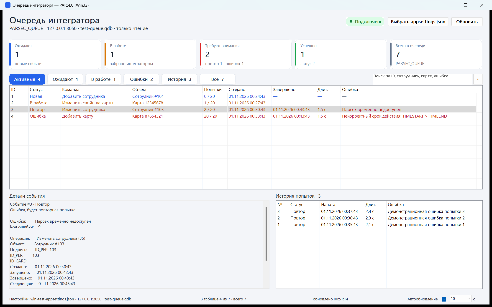

# ParsecQueueViewer.Win32

Win32-вариант монитора очереди интегратора. Главное окно и все элементы —
**обычные Win32-контролы**: `ListView`, `Edit`, `Button`, `ComboBox`, `Static`,
собственная отрисовка карточек и фильтров через GDI. WPF и WinForms в интерфейсе
не используются.

Код — C# под **.NET Framework 4.8** (он входит в Windows 10/11, отдельно ставить
не нужно). СУБД — Firebird через `FirebirdSql.Data.FirebirdClient` и native
`fbclient.dll`.



*На снимке — демонстрационные данные тестовой базы.*

## Размер и состав

Приложение поставляется одним управляемым exe. Внутри уже упакованы
`FirebirdSql.Data.FirebirdClient`, `System.Threading.Tasks.Extensions` и
`System.Runtime.CompilerServices.Unsafe`. Снаружи остаётся только native
`fbclient.dll`:

| Файл | Размер |
|---|---:|
| `ParsecQueueViewerWin32.exe` — всё managed-содержимое внутри | ≈ **1,30 МБ** |
| `fbclient.dll` (Firebird 1.5) — единственная внешняя DLL | ≈ **348 КБ** |
| **Итого приложение** | ≈ **1,64 МБ** |
| Папка с README и скриншотом | ≈ **1,77 МБ** |

ZIP — около **0,65 МБ**. Для сравнения: WPF-вариант с .NET 8 — 73 МБ на диске.

`.exe.config` не требуется: exe запускается на .NET Framework 4.8 без файла
настроек приложения.

## Возможности

- сводка по статусам `PARSEC_QUEUE`;
- таблица команд, фильтры, поиск, сортировка по колонкам;
- автообновление 5/10/30/60 секунд, `F5`, `Ctrl+F` — поиск, `Esc` — очистить;
- детали события, ошибка и история `PARSEC_QUEUE_LOG`;
- параметры подключения из `appsettings.json` интегратора;
- выбор `appsettings.json` стандартным диалогом Windows;
- только чтение: ни одного `INSERT/UPDATE/DELETE` в очередь.

Поиск конфигурации:

1. `--config <файл>`;
2. `%LOCALAPPDATA%\ParsecQueueViewerWin32\settings.ini`;
3. `PARSEC_INTEGRATOR_CONFIG`;
4. рядом с exe и в родительских каталогах;
5. путь службы из реестра;
6. стандартные каталоги установки.

Строка подключения и пароль на экран не выводятся.

## Запуск

```powershell
.\ParsecQueueViewer.Win32\bin\Release\net48\ParsecQueueViewerWin32.exe --config "C:\Program Files\ParsecIntegrationService\appsettings.json"
```

`fbclient.dll` копируется в выходную папку при сборке, если на машине установлен
Firebird 1.5 (`C:\Program Files (x86)\Firebird\Firebird_1_5_6\bin`) или 2.5.
Он должен лежать рядом с exe. Для другой установки:

```powershell
dotnet build .\ParsecQueueViewer.Win32\ParsecQueueViewer.Win32.csproj -c Release -p:FbClientSource=D:\Firebird\fbclient.dll
```

## Сборка одного exe

```powershell
.\build-win32.cmd
```

Скрипт собирает exe и кладёт в `Output\ParsecQueueViewerWin32_v1.0.0_single`
только `ParsecQueueViewerWin32.exe` и `fbclient.dll` (плюс README и скриншот).
ZIP: `Output\ParsecQueueViewerWin32_v1.0.0_single.zip`.

Приложение собирается как console-subsystem `Exe`, потому что Windows-subsystem
apphost на этом стенде завершается до входа в `Main`. Своё консольное окно
приложение прячет первым действием (`HideOwnConsole`), поэтому при запуске из
проводника видно только окно монитора. Если запускать из уже открытой консоли,
чужое окно не скрывается.

## Ограничения

- Нужен .NET Framework 4.8 (штатно есть в Windows 10/11).
- История ограничена последними 200 попытками на событие.
- Как и WPF-версия, активные строки читаются отдельно от последних 1000 строк истории.
- Для работы нужны таблицы `PARSEC_QUEUE` и `PARSEC_QUEUE_LOG` и право `SELECT` на них.
