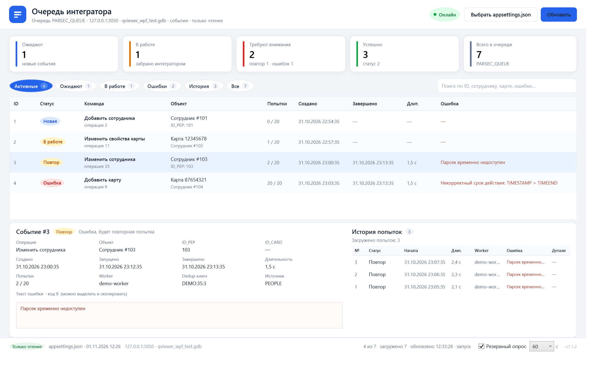

# ParsecQueueViewer — монитор очереди интегратора (WPF)

Небольшое Windows-приложение (WPF, .NET 8), которое показывает содержимое
`PARSEC_QUEUE` и историю попыток `PARSEC_QUEUE_LOG`. Предназначено для интегратора
и службы поддержки: не нужно открывать IBExpert и писать SQL, чтобы увидеть, что
стоит в очереди, что зависло и почему событие не уходит в Парсек.

Приложение **только читает** базу. Оно не меняет `PARSEC_QUEUE`, не удаляет строки,
не трогает `state.json` и не конкурирует со службой `ParsecIntegrationService`.
Запускать его можно при работающей службе.

WPF-монитор поставляется **одним автономным exe ≈72 МБ** с именем
`ParsecQueueViewerWpf.exe`: внутри .NET 8, WPF и провайдер Firebird, поэтому на
другом компьютере ничего доустанавливать не нужно — скопируйте файл и запустите.
Часть «Wpf» в имени отличает его от Win32-варианта `ParsecQueueViewerWin32.exe`,
чтобы обе версии можно было держать в одной папке. Если важен размер, есть
Win32-вариант: [ParsecQueueViewer.Win32](../ParsecQueueViewer.Win32/README.md) —
около 1,6 МБ, .NET Framework 4.8 (входит в Windows).



*На снимке — демонстрационные данные тестовой базы.*

## Что показывает

* сводку по всей очереди: новые, в работе, повторы, ошибки с исчерпанными попытками,
  успешные, всего;
* таблицу команд: ID, статус, операцию, сотрудника/карту/организацию, попытки,
  даты создания/завершения, длительность и текст ошибки;
* фильтры «Активные», «Ожидают», «В работе», «Ошибки», «История», «Все»;
* поиск по ID, статусу, операции, сотруднику, карте, ошибке, dedup-ключу и worker;
* детали выбранного события: все поля строки, полный текст ошибки (можно скопировать)
  и последние 200 попыток из `PARSEC_QUEUE_LOG`;
* обновление по событию Firebird `PARSEC_QUEUE_CHANGED`: таблица перечитывается сразу
  после того, как её изменила служба или триггеры (см. ниже);
* резервный опрос 5/10/30/60 секунд (по умолчанию 60), кнопка «Обновить», `F5`;
* индикатор источника данных: «Онлайн» — подписка на событие активна,
  «Опрос» — события недоступны и работает таймер, «Нет событий» — таймер выключен
  галочкой, а подписки нет;
* в нижней строке видно, чем вызвано последнее обновление: `запуск`, `событие`,
  `таймер`, `кнопка`, `F5`.

Активные строки читаются отдельно от «последних N»: даже старое необработанное
событие не потеряется среди тысяч успешных. История ограничена последними 1000
строками, активные — 5000; факт ограничения отмечается в нижней строке.

## Обновление по событиям Firebird

Опрос по таймеру остался только как страховка. Основной механизм — событие
Firebird: на `PARSEC_QUEUE` стоит триггер `PARSEC_QUEUE_EVENTS` (`AFTER INSERT OR
UPDATE OR DELETE`), который выполняет `POST_EVENT 'PARSEC_QUEUE_CHANGED'`.
Приложение держит отдельное подключение `FbRemoteEvent` в фоновом потоке и по
каждому событию перечитывает очередь. Firebird доставляет событие после `COMMIT`,
поэтому окно никогда не показывает незафиксированные данные.

Требование к базе: применить `db/08_parsec_queue_events.sql` (см.
[db/README.md](../db/README.md), раздел «События для монитора очереди»). Скрипт
пересоздаёт триггер, его можно запускать повторно. Событие одно на коммит: пачка
изменений от службы не вызывает пачки перечитываний — окно ждёт 250 мс после
последнего события и обновляется один раз.

Если события не работают, приложение не остаётся с устаревшими данными:

| Что видно | Что означает |
|---|---|
| «Онлайн», `обновлено … · событие` | подписка активна, данные пришли по событию |
| «Опрос», `обновлено … · таймер` | подписка потеряна (нет связи с базой) или триггер не установлен; работает резервный таймер |
| «Нет событий» | резервный опрос отключён галочкой, а подписка на событие недоступна — данные не обновляются |
| жёлтая плашка про `PARSEC_QUEUE_EVENTS` | в базе нет активного триггера: примените `db/08_parsec_queue_events.sql` |
| жёлтая плашка «События Firebird недоступны…» | подписка не открылась (нет связи, прав на события и т. п.); в плашке причина, данные идут по таймеру |

При обрыве связи слушатель переподключается сам (пауза 2 → 30 секунд), а данные
продолжает обновлять таймер. Кнопка «Обновить» и `F5` работают всегда.

## Откуда берутся параметры подключения

Монитор не хранит свою копию строки подключения и не переопределяет её. Он читает
`appsettings.json` службы интегратора:

1. путь из аргумента `--config <файл>`;
2. последний выбранный файл (хранится в `%LOCALAPPDATA%\ParsecQueueViewer\settings.json`);
3. переменная окружения `PARSEC_INTEGRATOR_CONFIG`;
4. `appsettings.json` рядом с монитором и в родительских каталогах
   (например, `publish\QueueViewer` → `publish\appsettings.json`);
5. каталог exe службы из реестра
   (`HKLM\SYSTEM\CurrentControlSet\Services\ParsecIntegrationService\ImagePath`);
6. стандартные каталоги: `C:\Program Files\ParsecIntegrationService`,
   `C:\IntegrationClient`, `C:\ArtonitServices\wrk`.

Используется `Service:DatabaseConnectionString`; если её нет, как и служба,
монитор смотрит прежний `_databaseConnectionString` в `<Paths:MainPath>\appsettings.json`.
Файл может содержать комментарии `//` — это тот же формат, что у службы.

Строка подключения целиком в интерфейс не выводится: только сервер, порт и имя
файла базы. Пароль в журналы и на экран не попадает.

Кнопка **«Выбрать appsettings.json»** позволяет указать файл вручную, если служба
установлена нестандартно или монитор запущен на другой машине.

## Запуск из исходников

```powershell
dotnet run --project .\ParsecQueueViewer\ParsecQueueViewer.csproj
```

С явным файлом настроек:

```powershell
dotnet run --project .\ParsecQueueViewer\ParsecQueueViewer.csproj -- --config "C:\Program Files\ParsecIntegrationService\appsettings.json"
```

Для сборки требуется .NET SDK 8.0 или новее (проверено на SDK 10.0.401), Windows x64
и доступ к nuget.org (FirebirdSql.Data.FirebirdClient 9.1.1). Для запуска готового
exe не нужно ничего: ни SDK, ни .NET, ни клиента Firebird.

## Сборка одного файла

```bat
build-wpf.cmd
```

Скрипт публикует автономный вариант и кладёт в
`Output\ParsecQueueViewerWpf_v1.1.2_single` ровно один файл —
`ParsecQueueViewerWpf.exe` (≈72 МБ). Его можно переносить на другой компьютер
без установки .NET: скопировал — запустил.

То же вручную:

```powershell
dotnet publish .\ParsecQueueViewer\ParsecQueueViewer.csproj -c Release -o .\publish\QueueViewer
```

Внутри exe — .NET 8, WPF и провайдер Firebird 9.1.1; отдельного `.pdb` нет
(символы встроены). `fbclient.dll` не нужен: провайдер обращается к серверу
Firebird по TCP по управляемому протоколу.

При старте хост распаковывает native-части WPF в `%TEMP%\.net\<имя>\<хэш>`.
Если на машине временный каталог закрыт для записи, задайте переменную
`DOTNET_BUNDLE_EXTRACT_BASE_DIR` (например,
`%LOCALAPPDATA%\ParsecQueueViewer\native`) — распаковка пойдёт туда.

Если нужен маленький exe (≈1,55 МБ) и на всех машинах установлен .NET 8
Desktop Runtime, соберите framework-dependent вариант:

```powershell
dotnet publish .\ParsecQueueViewer\ParsecQueueViewer.csproj -c Release -o .\publish\QueueViewer `
  -p:SelfContained=false -p:IncludeNativeLibrariesForSelfExtract=false -p:EnableCompressionInSingleFile=false
```

В папке `publish\QueueViewer` приложение находит `..\appsettings.json` службы;
при установке из `ParsecSetup.iss` — тот же файл на уровень выше.

`build.cmd` собирает службу и монитор, публикует монитор в `publish\QueueViewer`
и добавляет в установщик ярлык «Очередь интегратора» на
`ParsecQueueViewerWpf.exe`. В поставке монитора остаётся один exe;
`appsettings.json` службы, как и раньше, лежит отдельно.

## Требования к базе

На базе должны быть выполнены скрипты `db/01..03` (таблицы `PARSEC_QUEUE` и
`PARSEC_QUEUE_LOG`). Учётной записи из строки подключения нужно право `SELECT`
на обе таблицы. Для обновления по событиям дополнительно примените
`db/08_parsec_queue_events.sql`; без него монитор работает, но обновляется только
резервным таймером и предупреждает об этом жёлтой плашкой.

Отдельный клиент Firebird (`fbclient.dll`) на машине монитора не нужен: провайдер
9.1.1 работает по управляемому протоколу и подключается к серверу по TCP.

Firebird 1.5: события доставляются по отдельному сокету, поэтому монитор открывает
второе подключение к базе. Учётной записи нужно право на подключение (как и для
обычного чтения); прав на запись не требуется.

Если таблицы нет, монитор остаётся открытым и показывает понятную ошибку
с подсказкой применить `db/01..03`; службу он не затрагивает.

## Диагностика

Для снятия скриншота без участия пользователя (например, для документации):

```powershell
ParsecQueueViewerWpf.exe --config <appsettings.json> --screenshot <файл.png>
```

Приложение загрузит очередь, отрисует окно и завершится. Обычный запуск этот ключ
не использует.
